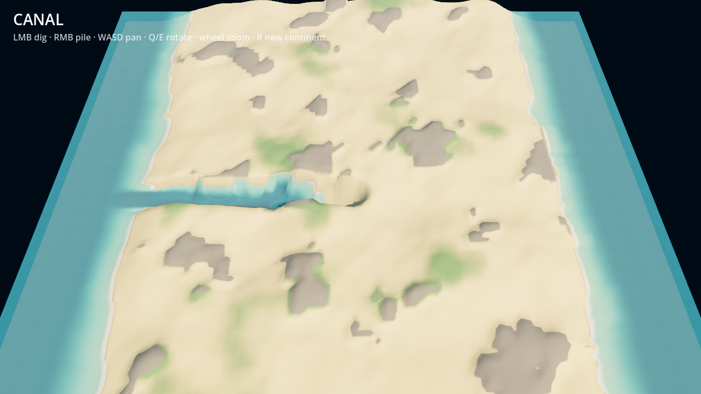
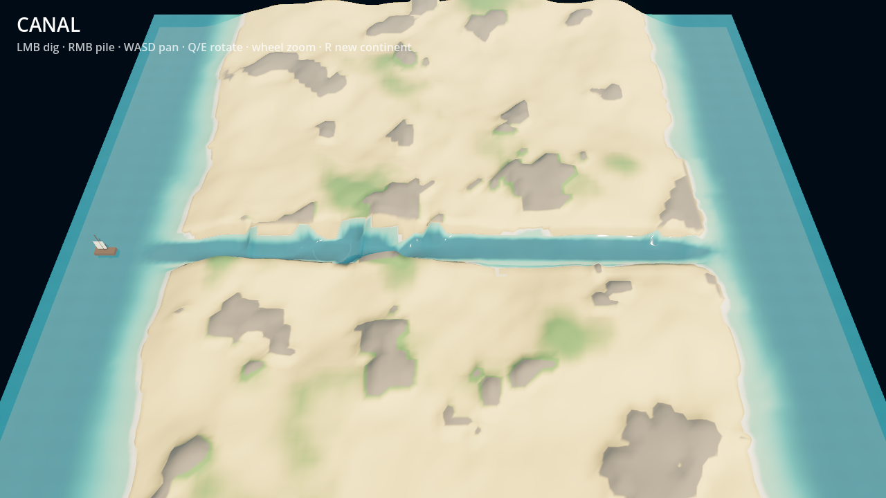
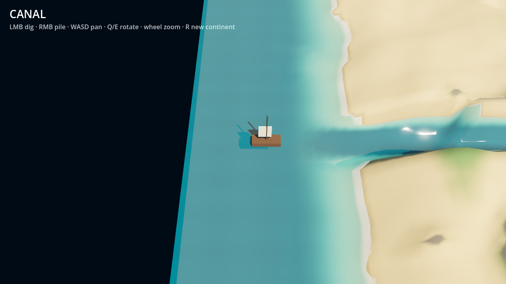

# Canal

대륙을 파서 두 바다를 잇는 3D 탑다운 샌드박스입니다. Godot 4.7로 만들었습니다.
삽으로 지형을 파면 바닷물이 낮은 곳을 따라 흘러 들어옵니다. 양쪽 바다가 배가 지날 수 있는 수심(0.3)으로 이어지면 배가 운하를 통과합니다. 승패는 없습니다.

```
지형 파기/쌓기 → 물이 흐름 → 두 바다가 이어졌나?
                    ↓ 아니오      ↓ 예
                 계속 파기     배가 운하를 통과
```

## 스크린샷

수로를 파는 중입니다. 바닷물이 파낸 곳을 따라 들어옵니다.



두 바다가 이어졌습니다. 왼쪽 바다에서 배가 운하로 들어옵니다.



운하 입구의 배를 가까이서 본 모습입니다.



## 실행

```sh
godot --path .                     # 플레이
godot --path . -- --autotest       # 자동 테스트: 운하를 파고 배 스폰 확인, shots/에 캡처
godot --path . --write-movie shots/take.avi -- --autotest   # 테스트 장면 녹화
```

## 조작

| 입력 | 동작 |
|---|---|
| 마우스 왼쪽 | 파기 |
| 마우스 오른쪽 | 흙 쌓기(제방) |
| WASD / 방향키 | 카메라 이동 |
| Q / E | 카메라 회전 |
| 휠 | 줌 |
| R | 새 대륙 생성 |

## 구조

| 파일 | 역할 |
|---|---|
| `main.gd` | 대륙 생성(FastNoiseLite), 물 시뮬레이션, 입력, 카메라, 운하 탐색(BFS), 배, 자동 테스트 |
| `terrain.gdshader` | 높이맵 텍스처로 정점 변위. 모래/풀/암반/파낸 모래/젖은 모래 색 |
| `water.gdshader` | 수면 높이 변위, 수심에 따른 색과 투명도, 해안 거품, 잔물결 |

- 그리드는 96×96이고 1칸이 1m입니다. 지형 높이, 수심, 암반, 원래 높이를 RGBA float 텍스처 하나에 담아 매 프레임 GPU로 올립니다.
- 물은 virtual pipe 모델로 시뮬레이션합니다. 운동량이 있어서 물이 긴 수로를 빠르게 채웁니다. 좌우 끝 열은 해수면 0으로 고정되어 무한한 바다 역할을 합니다.
- 암반(회색)은 4배 느리게 파집니다. 얇은 암반 턱 하나만 남아도 운하가 끊깁니다.
- 아트 에셋은 외부 파일 없이 셰이더와 Godot 기본 메시로 절차적으로 만듭니다.
